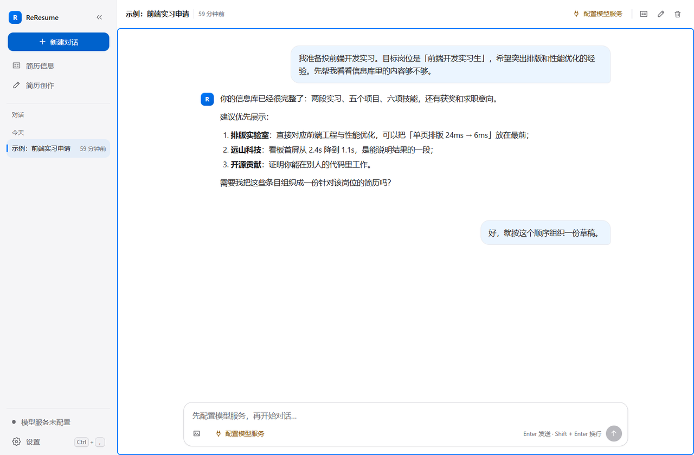
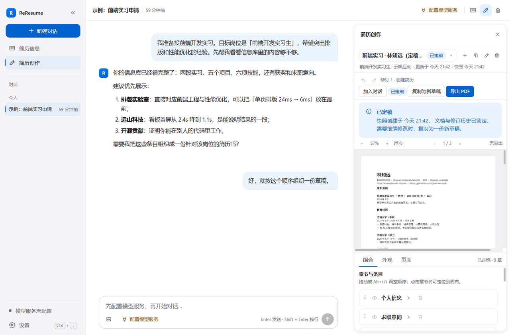
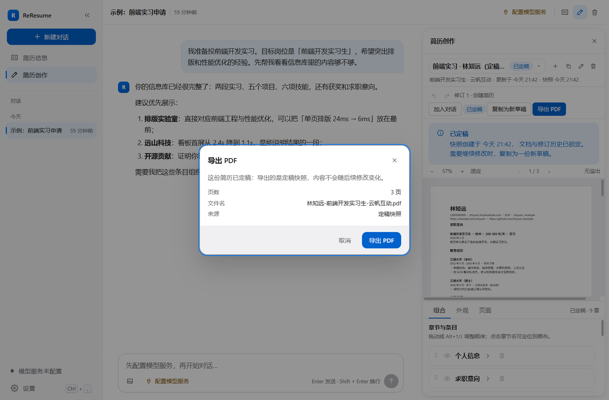
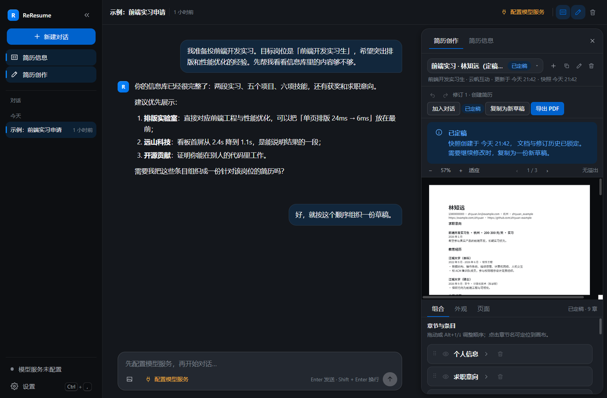

# ReResume

ReResume 是一个本地优先的简历工作台：信息库、简历创作、简历助手对话与 PDF 导出都在同一台
电脑上完成，不需要账号，也没有服务端。



## 功能

- **简历信息库**：个人、求职意向、教育、实习、项目、技能、奖项、自我评价与自定义模块；
  条目增删改查、搜索、排序、多模块视图，按模块类型校验字段。
- **简历创作**：多份简历互不影响；章节与条目组合、六套模板、强调色/字号/行高/间距/页面设置；
  按页画布支持自由块（文本、分隔线、图片）；修订链撤销/重做，定稿生成不可变快照。
- **简历助手**：流式回答、工具调用卡片、失败重试与取消；可把条目、简历加入对话上下文；
  支持粘贴/拖拽/选择图片，岗位截图与 JD 文本都能进入对话。
- **Agent 写入可追溯**：库变更与简历修订都记录来源；写操作卡片可单独撤销，并在右侧面板定位。
- **PDF 导出**：中文字体嵌入、矢量文字、分页与溢出检查；草稿导出当前内容，定稿导出快照；
  保存对话框由用户选择路径。
- **本地数据**：SQLite + 附件目录；API 密钥存放在口令解锁的 Stronghold 加密快照；
  支持 JSON 备份导出/校验导入、清空数据与孤儿附件清理。
- **界面**：浅色/深色/跟随系统主题、80%–140% 界面缩放、两档密度、减少动效、键盘快捷键。

## 截图

| 工作台（浅色） | 简历创作（浅色） |
| --- | --- |
|  |  |

| PDF 导出检查 | 工作台（深色） |
| --- | --- |
|  |  |

## 技术栈

| 层次 | 选型 |
| --- | --- |
| 语言 | TypeScript 5.9、Rust 1.90+ |
| 界面 | React 19、Zustand 5、原生 CSS 设计系统（CSS 自定义属性），无 UI 框架 |
| 容器 | Tauri 2（窗口、插件、打包；不承载业务逻辑） |
| 持久化 | SQLite（Tauri SQL 插件，参数化 SQL，手写迁移 1–10） |
| 密钥 | Tauri Stronghold（Argon2 派生口令） |
| 出站请求 | Tauri HTTP 插件（Rust 侧发起流式 SSE 与多模态请求） |
| Agent | TypeScript 工具调用循环，工具带风险等级，26 个工具，无 Agent 框架 |
| 画布 | Konva / React Konva |
| PDF | `@react-pdf/renderer` + fontkit 测量，内嵌 Noto Sans SC 子集 |
| 校验 | Zod |
| 测试 | Vitest（jsdom + 真实 Chromium）、Playwright（端到端与视觉）、架构依赖方向测试 |

### 架构

源码按依赖方向分层，由 `test/architecture/dependencyDirection.test.ts` 强制：

```text
domain/          纯领域模型与端口，不依赖任何包
application/     用例与端到端编排，只依赖 domain 与 zod
infrastructure/  SQLite、HTTP、Stronghold、附件文件、字体测量、PDF 渲染
presentation/    React 界面、Zustand store、CSS 设计系统
bootstrap/       组合根、Tauri 装配、浏览器预览装配
src-tauri/       原生容器：窗口、插件注册、迁移注册、附件/备份/导出命令
```

- 迁移版本只增不改；已应用的占位迁移正文有 sha256 守卫。当前版本 10。
- 浏览器预览用内存仓储装配与桌面相同的界面，`?preview` 仅在开发模式可用，生产构建不包含。
- 领域/应用逻辑不依赖 DOM 或 Tauri，可在 jsdom 中直接测试。

## 快速开始

前置条件：Windows 10/11（需 WebView2 运行时）或 macOS 10.15+（未在本项目验证）；
Node.js 24、pnpm 12；构建原生壳还需要 Rust 1.90+ 与 MSVC 工具链。

```bash
pnpm install --frozen-lockfile

pnpm dev            # 浏览器预览：http://localhost:1420/?preview
pnpm test           # Vitest：单元 + 浏览器项目
pnpm run test:e2e   # Playwright：真实 Chromium 端到端
pnpm run typecheck
pnpm run lint
pnpm run lint:css
pnpm run build      # 生产前端产物
```

### 桌面构建

```bash
pnpm tauri dev      # 真实 Tauri 窗口（开发）
pnpm tauri build    # Windows 发布构建
```

发布产物（Windows）：

- `src-tauri/target/release/re-resume.exe`
- `src-tauri/target/release/bundle/msi/ReResume_<version>_x64_en-US.msi`
- `src-tauri/target/release/bundle/nsis/ReResume_<version>_x64-setup.exe`

安装包未配置代码签名，首次运行可能触发 Windows SmartScreen 提示。

更多检查项、预览脚本参数与 CDP 真实窗口冒烟方法见 [CONTRIBUTING.md](CONTRIBUTING.md)
（[中文](CONTRIBUTING.zh.md)）。

## 数据与隐私

- 全部数据保存在本机，不上传任何服务器；没有遥测。
- Windows 数据目录：
  - `%APPDATA%\com.reresume.app\re-resume.db`：SQLite 数据库（会话、信息库、简历、设置）。
  - `%APPDATA%\com.reresume.app\attachments\`：图片附件与岗位截图文件。
  - `%APPDATA%\com.reresume.app\credentials.hold`：Stronghold 加密凭据快照。
  - `%LOCALAPPDATA%\com.reresume.app\stronghold-salt.bin`：密钥派生盐（与快照一起备份，丢失将无法解密凭据）。
- 数据库与附件未加密；API 密钥只进入 Stronghold，不写入数据库、导出文件或日志。
- 发起的对话只会在用户主动发送时访问设置中配置的模型服务；出站 HTTP 权限限定在
  `src-tauri/capabilities/default.json5` 列出的来源（当前为 Anthropic 与 OpenAI 官方端点）。
- 备份为 JSON 文件，包含数据库行与附件字节，可选择导出位置；导入前会校验文档版本与行形状。
- 安全模型与漏洞报告见 [SECURITY.md](SECURITY.md)（[中文](SECURITY.zh.md)）。

## 目录结构

```text
src/
  domain/          领域模型、端口、模板、布局与校验规则
  application/     用例（信息库、简历、会话、Agent 工具、导出、备份）
  infrastructure/  SQLite 仓储、HTTP 适配器、Stronghold、附件、PDF、测量
  presentation/    React 界面、store、画布、设置、主题与 CSS
  bootstrap/       组合根、Tauri 与预览装配、启动流程
src-tauri/
  src/             窗口入口、迁移注册、附件/备份/连接/导出命令
  capabilities/    最小权限声明
  tauri.conf.json  CSP、窗口与打包配置
test/              单元、浏览器、架构与持久化测试
e2e/               Playwright 端到端用例
docs/screenshots/  最终界面截图
```

## 已知限制

- **macOS 未验证**：代码与配置按 macOS 10.15+ 编写，但只在 Windows 上完成构建与真机验证。
- **DOCX 不在范围**：本轮只支持 PDF 导出。
- **自定义模型端点**：容器只放行能力文件中列出的模型服务来源；使用自建 OpenAI 兼容端点需要
  修改该文件并重新构建安装包。
- **Agent 需要用户自备模型服务**：应用不附带密钥或代理；未配置模型服务时只能使用本地信息库、
  简历创作与导出。
- **安装包未签名**：发布构建未配置代码签名与自动更新。
- **单窗口**：不提供多窗口并排；面板分栏只在窗口足够宽（≥1560 CSS 像素）时并排，否则以
  标签页切换单个面板。
- **性能边界**：单会话消息预算 2000 条、修订活链 200、变更记录 1000 行；超出后按既定策略
  提示或清理。图片缩略图读取原图字节后缩放显示，超大图片的读取与解码耗时取决于机器。
- **自由画布**：自由块支持文本、分隔线与图片，可拖动/缩放/调整层级；不支持旋转与富文本混排。
- **中文字体**：PDF 固定使用 Noto Sans SC；未提供第二套衬线中文字体。
- **浏览器预览**：`?preview` 只在开发模式可用，生产包不暴露演示模式。

## 开发与贡献

开发流程、检查项、预览与发布步骤见 [CONTRIBUTING.md](CONTRIBUTING.md)
（[中文](CONTRIBUTING.zh.md)）。
安全策略见 [SECURITY.md](SECURITY.md)（[中文](SECURITY.zh.md)）。

## 许可证

[Apache License 2.0](LICENSE)。
